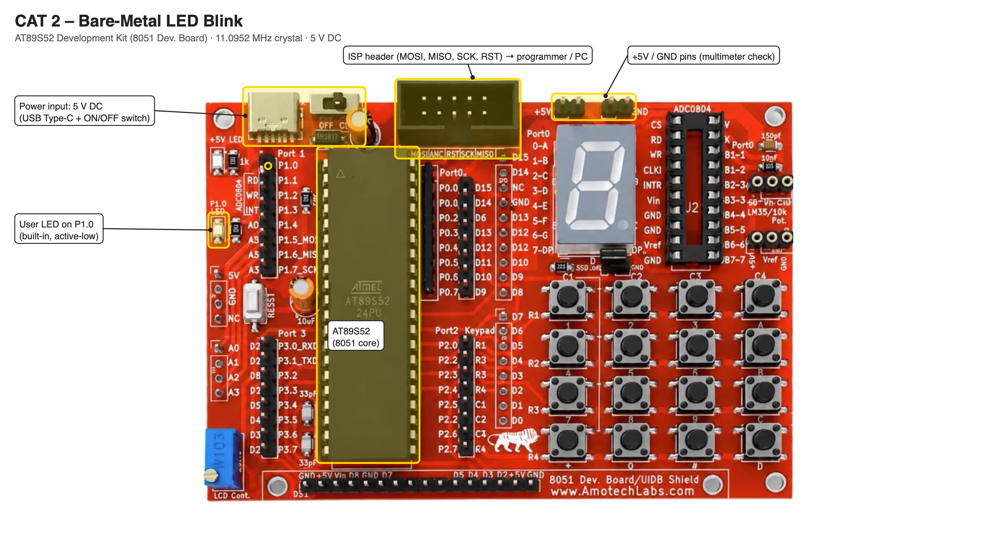

# EXPERIMENT DETAILS

**EXP:** CONTINUOUS ASSESSMENT 2

**DATE:** DD/MM/YYYY

**NAME OF EXP:** 8051 Tool Chain Setup – Development Board – AT89S52

**HARDWARE SETUP / PLATFORM:** AT89S52 Development Kit (11.0952 MHz crystal) + Keil µVision (C51)

---

## TASK 1 : Hardware Board Bring-Up

### 1. Circuit Diagram

- **Microcontroller:** AT89S52 (8051 core) on the AT89S52 development kit
- **Programmer:** ISP (In-System Programming) over SPI: P1.5 (MOSI), P1.6 (MISO), P1.7 (SCK), RST
- **User LED:** Built-in LED on P1.0 (active-low)
- **Power Supply:** 5V DC; VCC on pin 40, GND on pin 20

### 2. Core Logic / Pseudocode / Code Base

**Working Principle:**

The board components were identified, the power rail was verified with a digital multimeter, and the LED's GPIO port and pin were identified from the board schematic. The host PC was then connected to the board and the program was flashed to the AT89S52 over ISP.

| Parameter | Student Entry |
|---|---|
| MCU | AT89S52 |
| CPU Core | 8051 (MCS-51), 8-bit |
| Operating Voltage | 5 V (4.0 V – 5.5 V) |
| Debug Interface | No on-chip debugger; programmed through ISP over SPI |
| LED GPIO Port | Port 1 |
| LED GPIO Pin | P1.0 (built-in) |
| LED Active State | Active-low (the LED turns on when P1.0 = 0) |
| LED Frequency (Hz) | ≈ 1 Hz (0.5 s ON, 0.5 s OFF) |

**Pseudocode:**

1. Identify the microcontroller, programmer, power source, user LED and its GPIO pin.
2. Measure the 5 V supply between VCC (pin 40) and GND (pin 20) with a digital multimeter.
3. Identify the LED port and pin (P1.0) and its active-low wiring from the schematic.
4. Connect the board to the host PC, build the project in Keil µVision and flash the HEX file over ISP.

**Code Base:**

No program is required for this task; the Task 2 program is used to verify the toolchain and the board.

### 3. Inference

The AT89S52 board was brought up successfully: the supply voltage was verified, the user LED was located on P1.0 (active-low), and the host PC could program the microcontroller.

---

## TASK 2 : Bare-Metal LED Blink

### 1. Circuit Diagram

- **Microcontroller:** AT89S52 (8051 core) on the AT89S52 development kit
- **GPIO Port:** Port 1
- **GPIO Pin:** P1.0
- **Peripheral:** Built-in user LED (active-low)
- **Power Supply:** 5V DC

### 2. Core Logic / Pseudocode / Code Base

**Working Principle:**

P1.0 is mapped directly onto bit 0 of the Port 1 register with `sbit`, so writing to it changes the pin without any library. The 8051 has no pin-direction register, so writing to the bit is the whole output configuration. A software loop provides the delay. With 200 × 400 loop passes, each `delay()` lasts about 0.5 s at 11.0952 MHz, so the LED blinks at about 1 Hz.

**Pseudocode:**

1. Include the 8051 register definition header file.
2. Define P1.0 as the LED control pin.
3. Create a delay function using nested loops (200 × 400 passes ≈ 0.5 s).
4. Set P1.0 HIGH (LED OFF, active-low) and call the delay.
5. Set P1.0 LOW (LED ON) and call the delay.
6. Repeat continuously.

**Code Base:**

- **Project folder:** [`TASK_2_Bare_Metal_LED_Blink`](TASK_2_Bare_Metal_LED_Blink/)
- `reg51.h` provides the 8051 register definitions.
- `sbit led = P1^0` assigns the LED to pin P1.0.
- `delay()` uses nested `for` loops; one machine cycle is 12 / 11.0952 MHz ≈ 1.0815 µs.

### 3. Inference

The LED on P1.0 blinks at about 1 Hz, demonstrating direct register access to GPIO and software-loop timing on the 8051.

---

## TASK 3 : Customed Library Function for Delay Functionality

### 1. Circuit Diagram

- **Microcontroller:** AT89S52 (8051 core) on the AT89S52 development kit
- **GPIO Port:** Port 1
- **GPIO Pin:** P1.0
- **Peripheral:** Built-in user LED (active-low)
- **Power Supply:** 5V DC

### 2. Core Logic / Pseudocode / Code Base

**Working Principle:**

The delay is moved into a separate library, `delay.h` / `delay.c`, so any program can include it. `delay_ms(ms)` repeats a calibrated inner loop of about 1 ms: two 153-pass loops of 3 machine cycles each (about 925 cycles ≈ 1 ms at 11.0952 MHz). The LED blink program calls `delay_ms(500)` to blink at 1 Hz.

**Pseudocode:**

1. Declare `delay_ms(unsigned int ms)` in `delay.h`.
2. In `delay.c`, repeat `ms` times: run the two calibrated inner loops (≈ 1 ms).
3. In the main program, include `delay.h`.
4. Set P1.0 HIGH (LED OFF) and call `delay_ms(500)`.
5. Set P1.0 LOW (LED ON) and call `delay_ms(500)`.
6. Repeat continuously.

**Code Base:**

- **Project folder:** [`TASK_3_Custom_Delay_Library`](TASK_3_Custom_Delay_Library/)
- `delay.h` declares `delay_ms()`; `delay.c` implements it; both are added to the Keil project.
- `prog1.c` blinks the LED with `delay_ms(500)`.

### 3. Inference

Moving the delay into its own library with a millisecond parameter makes the timing reusable and readable: `delay_ms(500)` states the intended time directly, instead of loop counts inside the application.
