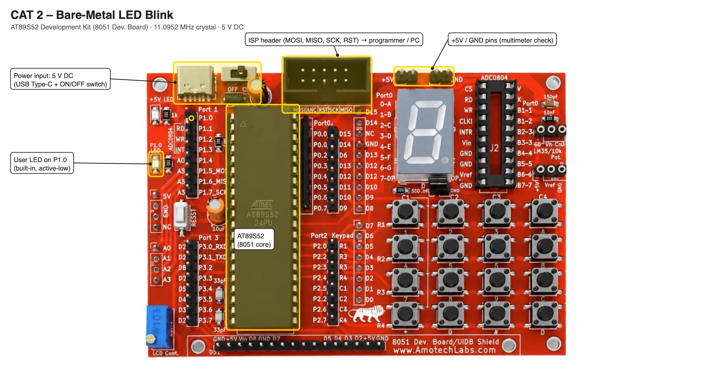

# TASK 2B Bare-Metal LED Blink

**Experiment:** [CONTINUOUS ASSESSMENT 2 – 8051 Tool Chain Setup – Development Board – AT89S52](../README.md)

---

### 1. Hardware Used

- **Microcontroller:** AT89S52 (8051 core) on the AT89S52 development kit
- **GPIO Port:** Port 1
- **GPIO Pin:** P1.0
- **Peripheral:** Built-in user LED (active-low)
- **Power Supply:** 5V DC

### 2. Core Logic / Pseudocode / Code Base

**Working Principle:**

P1.0 is mapped directly onto bit 0 of the Port 1 register with `sbit`, so writing to it changes the pin without any library. The 8051 has no pin-direction register, so writing to the bit is the whole output configuration. A software loop provides the delay. With 200 × 400 loop passes, each `delay()` lasts about 0.5 s at 11.0952 MHz, so the LED blinks at about 1 Hz.

**Pseudocode:**

1. Include the 8051 register definition header file.
2. Define P1.0 as the LED control pin.
3. Create a delay function using nested loops (200 × 400 passes ≈ 0.5 s).
4. Set P1.0 HIGH (LED OFF, active-low) and call the delay.
5. Set P1.0 LOW (LED ON) and call the delay.
6. Repeat continuously.

**Code Base:**

- `reg51.h` provides the 8051 register definitions.
- `sbit led = P1^0` assigns the LED to pin P1.0.
- `delay()` uses nested `for` loops; one machine cycle is 12 / 11.0952 MHz ≈ 1.0815 µs.

### 3. Inference

The LED on P1.0 blinks at about 1 Hz, demonstrating direct register access to GPIO and software-loop timing on the 8051.
