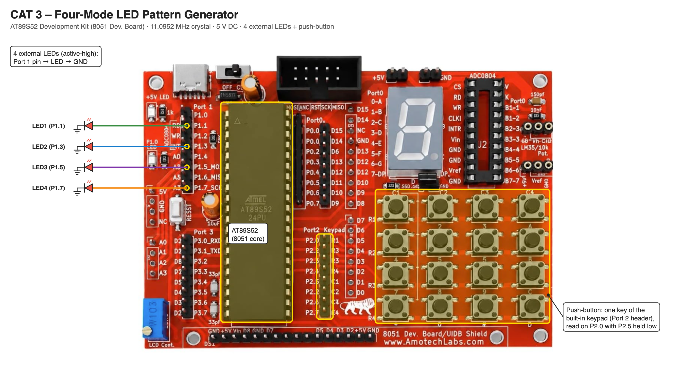

# EXPERIMENT DETAILS

**EXP:** CONTINUOUS ASSESSMENT 3

**DATE:** DD/MM/YYYY

**NAME OF EXP:** Timer-Based LED Pattern Generator and Button Interrupt Controller

**HARDWARE SETUP / PLATFORM:** AT89S52 Development Kit (11.0952 MHz crystal) + Keil µVision (C51) + 4 LEDs + Push-Button

---

## ACTIVITY : Four-State LED Control System

### 1. Circuit Diagram

- **Microcontroller:** AT89S52 (8051 core) on the AT89S52 development kit
- **GPIO Port / Pins (LEDs):** Port 1 – P1.1 (LED1), P1.3 (LED2), P1.5 (LED3), P1.7 (LED4)
- **GPIO Port / Pins (Button):** Port 2 – P2.0 (keypad row, input), P2.5 (keypad column, held low)
- **Peripherals:** 4 external LEDs (active-high, anode to the port pin, cathode to GND); one key of the kit's built-in keypad as the push-button
- **Power Supply:** 5V DC

### 2. Core Logic / Pseudocode / Code Base

**Working Principle:**

The four LEDs are outputs on Port 1 and the push-button is read on P2.0 while its column P2.5 is held low. The system is a state machine held in the variable `mode`. Each debounced press advances the mode 0 → 1 → 2 → 3 → 4 → 1 and resets the pattern counters. A press is accepted only if P2.0 is still low after about 10 ms (debouncing).

| Mode | LED behaviour (LED1 LED2 LED3 LED4) |
|---|---|
| 0 | All OFF (power-on) |
| 1 | Running LED: 1000 → 0100 → 0010 → 0001 |
| 2 | Binary counter 0000 → 1111 |
| 3 | Alternating 1010 ↔ 0101 |
| 4 | All LED flash 1111 ↔ 0000 |

**Pseudocode:**

1. Define the four LED pins and the keypad row/column pins.
2. Hold the column low, turn all LEDs OFF and set `mode = 0`.
3. If the button is pressed and still pressed after ≈ 10 ms, advance `mode` and reset the counters.
4. Mode 1: light only the LED at `pos`, then move to the next position.
5. Mode 2: output `count` in binary on the LEDs, then increment it (0–15).
6. Mode 3: alternate between 1010 and 0101.
7. Mode 4: alternate between all ON and all OFF.
8. Wait ≈ 0.3 s and repeat.

**Code Base:**

- `sbit` maps each LED and keypad line to its port bit.
- `btn()` reads the button with a second read after a software delay (debouncing).
- `wait(ms)` is the software delay used between pattern steps.
- `mode`, `pos`, `count`, `alt` and `flash` hold the state of the system.

### 3. Inference

Each press of the button moves the system to the next LED mode. Representing the four modes as states of one variable and debouncing the button in software gives a predictable four-state LED controller using only register-level GPIO access.
