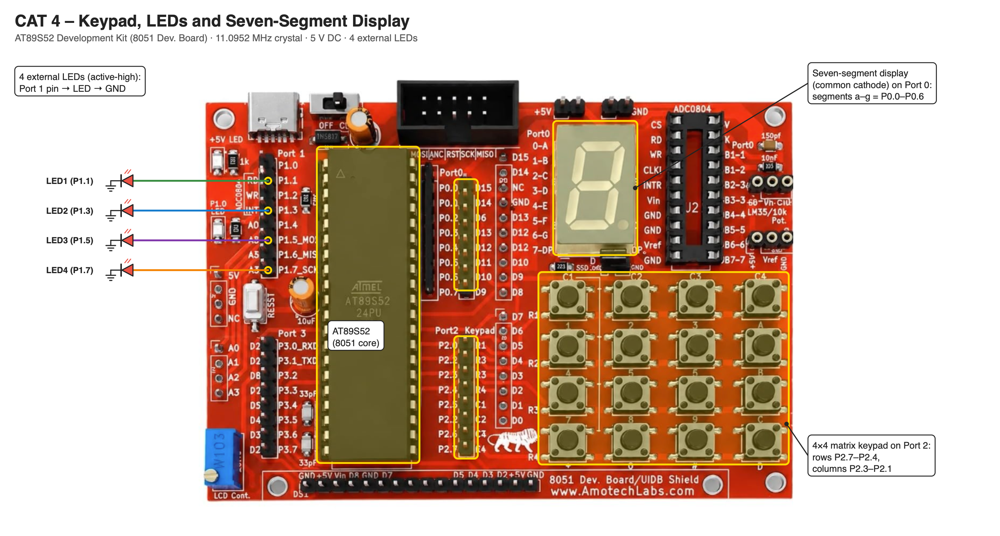

# EXPERIMENT DETAILS

**EXP:** CONTINUOUS ASSESSMENT 4

**DATE:** DD/MM/YYYY

**NAME OF EXP:** Human-Machine Interface using Matrix Keypad, LEDs, and Seven-Segment Display

**HARDWARE SETUP / PLATFORM:** AT89S52 Development Kit (11.0952 MHz crystal) + Keil µVision (C51) + 4×4 Matrix Keypad + Seven-Segment Display + 4 LEDs

---

## TASK : Keypad-Controlled Seven-Segment Display and LED Operations

### 1. Circuit Diagram

- **Microcontroller:** AT89S52 (8051 core) on the AT89S52 development kit
- **Keypad:** Built-in matrix keypad on Port 2 – rows P2.7–P2.4, columns P2.3–P2.1
- **Seven-Segment Display:** Built-in common-cathode display on Port 0 – segments a–g on P0.0–P0.6
- **LEDs:** 4 external LEDs on P1.1, P1.3, P1.5, P1.7 (active-high, cathode to GND)
- **Power Supply:** 5V DC

### 2. Core Logic / Pseudocode / Code Base

**Working Principle:**

The keypad is scanned by driving one row low at a time and reading the columns; a key is accepted after a ≈ 10 ms debounce re-read. The key value is shown on the seven-segment display by writing its segment code to P0, and the corresponding LED operation is selected:

| Key | Display | LED Operation |
|---|---|---|
| 1 – 4 | 1 – 4 | LED1 – LED4 ON |
| 5 | 5 | Running LED pattern |
| 6 | 6 | Alternate LEDs (1010 ↔ 0101) |
| 7 | 7 | Binary counter (0–15) |
| 8 | 8 | All LEDs blink |
| 9 | 9 | All LEDs OFF |
| 0 | 0 | Reset system |

**Pseudocode:**

1. Turn all LEDs OFF and blank the display.
2. Scan the keypad: drive each row low and check each column; debounce the key.
3. If a key is pressed, show its digit on the seven-segment display.
4. Select the LED operation for the key and set the matching mode flag (running, alternate, binary, blink).
5. Key 0 clears every mode flag and turns all LEDs OFF.
6. Advance the active pattern by one step, wait, and repeat.

**Code Base:**

- `btn()` scans the keypad and returns the debounced key (0–9) or −1.
- `displayNumber()` writes the common-cathode segment code (`0x3F`, `0x06`, … `0x6F`) to P0.
- `glowLed()`, `glowPair()`, `glowAll()` and `glowBinary()` drive the LED patterns.
- `runningLed`, `altLed`, `blinkLed` and `binLed` select the active mode; `delay()` sets the step time.

### 3. Inference

Every key pressed is shown on the seven-segment display and triggers its LED function. Scanning the matrix keypad row by row reads 12 keys with 7 port pins, and separating keypad, display and LED functions keeps the human-machine interface easy to extend.
