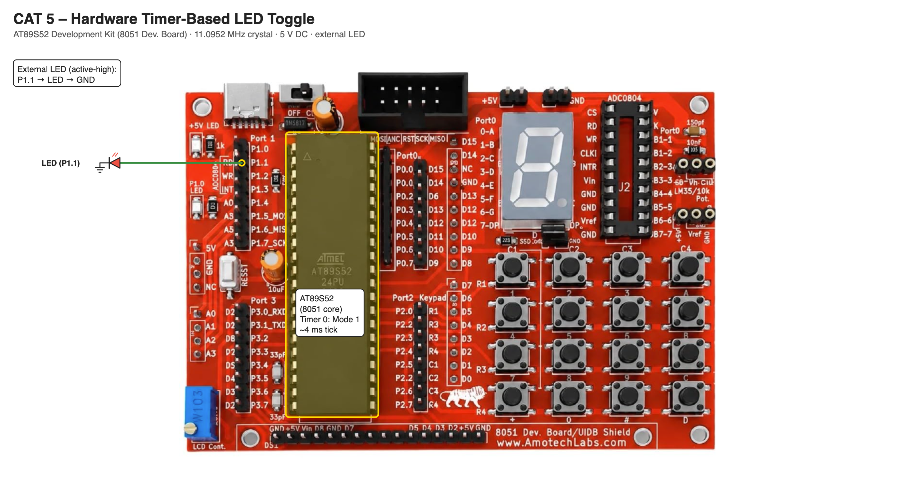

# EXPERIMENT DETAILS

**EXP:** CONTINUOUS ASSESSMENT 5

**DATE:** DD/MM/YYYY

**NAME OF EXP:** Hardware Timer and Interrupt-Based Timing for LED Fading, Pulse Generation, and Stepper Motor Control

**HARDWARE SETUP / PLATFORM:** AT89S52 Development Kit (11.0952 MHz crystal) + Keil µVision (C51) + LED

---

## TASK 1 : Timer 0 Software Time Base and LED Toggle

### 1. Circuit Diagram

- **Microcontroller:** AT89S52 (8051 core) on the AT89S52 development kit
- **GPIO Port / Pin:** Port 1 – P1.1
- **Peripheral:** External LED (active-high, cathode to GND); Timer 0 (internal)
- **Power Supply:** 5V DC

### 2. Core Logic / Pseudocode / Code Base

**Working Principle:**

Timer 0 runs in Mode 1 (16-bit) and counts machine cycles (12 / 11.0952 MHz ≈ 1.0815 µs). It is preloaded with 0xF199, so it overflows after 65536 − 61849 = 3687 counts ≈ 4 ms and sets the overflow flag TF0. The program counts the overflows as a software time base and toggles the LED every 200 overflows (≈ 0.8 s). No software delay loop is used for the timing.

Crystal (11.0952 MHz) → Machine Cycle → Timer Counter → Overflow (TF0) → Software Time Base → LED control

**Pseudocode:**

1. Start Timer 0 and set Mode 1 (`TMOD = 0x01`).
2. Load the preload 0xF199 into TH0/TL0 and clear TF0.
3. Turn the LED ON.
4. When TF0 is set (≈ 4 ms passed), increment `count` and reload the timer.
5. When `count` reaches 200, toggle the LED and reset `count`.
6. Repeat continuously.

**Code Base:**

- `TMOD = 0x01` selects Timer 0, Mode 1; `TR0 = 1` starts the timer.
- `initTimer()` loads `TH0 = 0xF1`, `TL0 = 0x99` and clears `TF0`.
- `count` is the software time base; `led = !led` toggles P1.1.

### 3. Inference

The LED toggles at a fixed interval generated by the hardware timer, independent of the instructions in the main loop. The hardware generates the timing and the software responds to the timer's overflow event.
