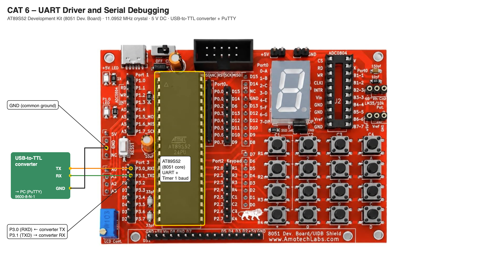

# EXPERIMENT DETAILS

**EXP:** CONTINUOUS ASSESSMENT 6

**DATE:** DD/MM/YYYY

**NAME OF EXP:** UART Driver and Serial Debugging

**HARDWARE SETUP / PLATFORM:** AT89S52 Development Kit (11.0952 MHz crystal) + Keil µVision (C51) + USB-to-TTL Serial Converter + PuTTY

---

## TASK A — UART Initialization and Character Transmission

### 1. Circuit Diagram

- **Microcontroller:** AT89S52 (8051 core) on the AT89S52 development kit
- **UART Pins:** P3.1 (TXD) → USB-to-TTL RX, P3.0 (RXD) ← USB-to-TTL TX
- **Peripheral:** USB-to-TTL serial converter connected to the PC running PuTTY (9600-8-N-1)
- **Power Supply:** 5V DC; converter GND connected to board GND

### 2. Core Logic / Pseudocode / Code Base

**Working Principle:**

The serial port is set to Mode 1, an 8-bit UART with a variable baud rate, with reception enabled (`SCON = 0x50`). Timer 1 in Mode 2 (8-bit auto-reload, `TMOD = 0x20`) generates the baud rate; with `TH1 = 0xFD` the rate is 11.0952 MHz / (12 × 32 × 3) ≈ 9631 baud, within tolerance of 9600. A character is transmitted by writing it to SBUF and waiting for the TI flag, and received by waiting for the RI flag and reading SBUF. The program transmits the string `Hello from 8051` continuously, followed by CR/LF and a short pause.

**Pseudocode:**

1. Configure the UART: `SCON = 0x50`, `TMOD = 0x20`, `TH1 = TL1 = 0xFD`, start Timer 1.
2. For each character of `Hello from 8051`: write it to SBUF, wait until TI = 1, clear TI.
3. Send `\r\n` to move to a new line.
4. Wait for a short software delay.
5. Repeat continuously.

**Code Base:**

- **Project folder:** [`TASK_A_UART_Initialization_and_Character_Transmission`](TASK_A_UART_Initialization_and_Character_Transmission/)
- `initUART()` configures 9600-8-N-1.
- `sendChar()` writes SBUF and waits for TI; `sendString()` sends a string followed by `\r\n`.

### 3. Inference

`Hello from 8051` appears repeatedly in PuTTY, verifying the UART configuration, the baud rate and the transmit path.

---

## TASK B — UART Echo

### 1. Circuit Diagram

- **Microcontroller:** AT89S52 (8051 core) on the AT89S52 development kit
- **UART Pins:** P3.1 (TXD) → USB-to-TTL RX, P3.0 (RXD) ← USB-to-TTL TX
- **Peripheral:** USB-to-TTL serial converter connected to the PC running PuTTY (9600-8-N-1)
- **Power Supply:** 5V DC; converter GND connected to board GND

### 2. Core Logic / Pseudocode / Code Base

**Working Principle:**

The serial port is set to Mode 1, an 8-bit UART with a variable baud rate, with reception enabled (`SCON = 0x50`). Timer 1 in Mode 2 (8-bit auto-reload, `TMOD = 0x20`) generates the baud rate; with `TH1 = 0xFD` the rate is 11.0952 MHz / (12 × 32 × 3) ≈ 9631 baud, within tolerance of 9600. A character is transmitted by writing it to SBUF and waiting for the TI flag, and received by waiting for the RI flag and reading SBUF. After sending a greeting, the program receives each character typed in PuTTY and immediately transmits it back (PC → 8051 → PC).

**Pseudocode:**

1. Configure the UART for 9600-8-N-1.
2. Send `Hello from 8051!!!` once.
3. Wait until RI = 1, read the character from SBUF and clear RI.
4. Transmit the same character back.
5. Repeat continuously.

**Code Base:**

- **Project folder:** [`TASK_B_UART_Echo`](TASK_B_UART_Echo/)
- `getChar()` waits for RI and reads SBUF; `sendChar()` transmits the character back.

### 3. Inference

Everything typed in PuTTY (for example `Hello 8051` or `ABC123`) is returned by the 8051, confirming that both the receive and transmit paths of the UART work.
