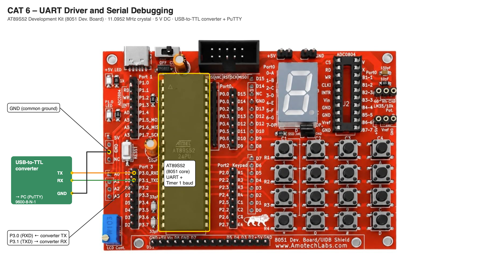

# TASK 6B UART Echo

**Experiment:** [CONTINUOUS ASSESSMENT 6 – UART Driver and Serial Debugging](../README.md)

---

### 1. Hardware Used

- **Microcontroller:** AT89S52 (8051 core) on the AT89S52 development kit
- **UART Pins:** P3.1 (TXD) → USB-to-TTL RX, P3.0 (RXD) ← USB-to-TTL TX
- **Peripheral:** USB-to-TTL serial converter connected to the PC running PuTTY (9600-8-N-1)
- **Power Supply:** 5V DC; converter GND connected to board GND

### 2. Core Logic / Pseudocode / Code Base

**Working Principle:**

The serial port is set to Mode 1, an 8-bit UART with a variable baud rate, with reception enabled (`SCON = 0x50`). Timer 1 in Mode 2 (8-bit auto-reload, `TMOD = 0x20`) generates the baud rate; with `TH1 = 0xFD` the rate is 11.0952 MHz / (12 × 32 × 3) ≈ 9631 baud, within tolerance of 9600. A character is transmitted by writing it to SBUF and waiting for the TI flag, and received by waiting for the RI flag and reading SBUF. After sending a greeting, the program receives each character typed in PuTTY and immediately transmits it back (PC → 8051 → PC).

**Pseudocode:**

1. Configure the UART for 9600-8-N-1.
2. Send `Hello from 8051!!!` once.
3. Wait until RI = 1, read the character from SBUF and clear RI.
4. Transmit the same character back.
5. Repeat continuously.

**Code Base:**

- `getChar()` waits for RI and reads SBUF; `sendChar()` transmits the character back.

### 3. Inference

Everything typed in PuTTY (for example `Hello 8051` or `ABC123`) is returned by the 8051, confirming that both the receive and transmit paths of the UART work.
