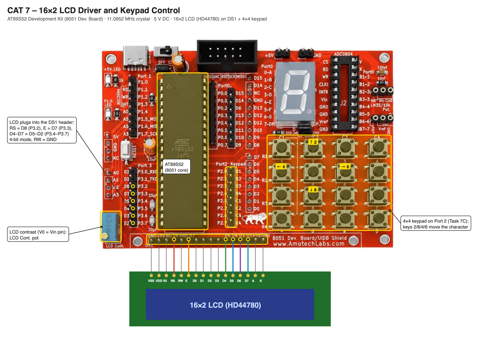

# EXPERIMENT DETAILS

**EXP:** CONTINUOUS ASSESSMENT 7

**DATE:** DD/MM/YYYY

**NAME OF EXP:** 16×2 LCD Driver Development and Dynamic Display Control

**HARDWARE SETUP / PLATFORM:** AT89S52 Development Kit (11.0952 MHz crystal) + Keil µVision (C51) + 16×2 LCD (HD44780) + 4×4 Matrix Keypad

---

## TASK 7A — LCD Initialization and Character/String Display

### 1. Circuit Diagram

- **Microcontroller:** AT89S52 (8051 core) on the AT89S52 development kit
- **LCD Pins:** RS → P3.2, E → P3.3, D4–D7 → P3.4–P3.7 (4-bit mode)
- **Peripheral:** Built-in 16×2 character LCD (HD44780-compatible)
- **Power Supply:** 5V DC

### 2. Core Logic / Pseudocode / Code Base

**Working Principle:**

`lcd_init()` follows the HD44780 4-bit start-up sequence: three `0011` nibbles, then `0010` to switch to 4-bit mode, followed by Function Set `0x28` (4-bit, 2 lines, 5×8 font), Display Control `0x0C` (display ON, cursor OFF), Entry Mode `0x06` (cursor moves right) and Clear Display `0x01`. `lcd_cmd()` sends a command with RS = 0 and `lcd_data()` sends a character with RS = 1; each byte is sent as two nibbles, latched on the falling edge of E. The cursor is placed with Set DDRAM Address commands: `0x80` is the first position of row 1 and `0xC0` the first position of row 2.

**Pseudocode:**

1. Initialize the LCD in 4-bit, 2-line mode with `lcd_init()`.
2. Send `0x80` and display the character `A` at the first position of the first row.
3. Send `0x82` and display the string `HELLO` character by character.
4. Send `0xC0` and display the string `8051 LCD DRIVER` on the second row.

**Code Base:**

- **Project folder:** [`TASK_7A_LCD_Initialization_and_Character_String_Display`](TASK_7A_LCD_Initialization_and_Character_String_Display/)
- `send_nibble()` drives D7–D4 and pulses E; `lcd_write()` sends a byte as two nibbles.
- `lcd_init()`, `lcd_cmd()` and `lcd_data()` form the driver.

### 3. Inference

The character `A` and the two strings appear on both rows of the LCD. The commands and their bit fields come directly from the HD44780 datasheet.

---

## TASK 7B — Cursor Positioning and Dynamic Value Update

### 1. Circuit Diagram

- **Microcontroller:** AT89S52 (8051 core) on the AT89S52 development kit
- **LCD Pins:** RS → P3.2, E → P3.3, D4–D7 → P3.4–P3.7 (4-bit mode)
- **Peripheral:** Built-in 16×2 character LCD (HD44780-compatible)
- **Power Supply:** 5V DC

### 2. Core Logic / Pseudocode / Code Base

**Working Principle:**

The driver from Task 7A is extended with cursor positioning and value display. `lcd_goto(row, col)` sends `0x80 + col` for row 1 or `0xC0 + col` for row 2. `lcd_puts()` writes a string and `lcd_print_number()` converts a number into digits (`value % 10 + '0'`) and prints them in order. The program shows `HI DA` on row 1 and `Shift:` with a changing number on row 2, then shifts the display right (`0x1C`) 22 times before returning home (`0x02`).

**Pseudocode:**

1. Initialize the LCD.
2. Display `HI DA` at (0, 0) and `Shift:` at (1, 0).
3. Clear the old number at (1, 7) and print the current shift count.
4. If the count is 22, send Return Home and reset the count; otherwise shift the display right and increment the count.
5. Wait and repeat.

**Code Base:**

- **Project folder:** [`TASK_7B_Cursor_Positioning_and_Dynamic_Value_Update`](TASK_7B_Cursor_Positioning_and_Dynamic_Value_Update/)
- `lcd_goto(row, column)`, `lcd_puts(string)` and `lcd_print_number(value)` build on `lcd_cmd()` and `lcd_data()`.

### 3. Inference

The cursor can be placed at any row and column, and the number on row 2 updates on every step without rewriting the rest of the display.

---

## TASK 7C — 4×4 Keypad-Based Character Movement

### 1. Circuit Diagram

- **Microcontroller:** AT89S52 (8051 core) on the AT89S52 development kit
- **LCD Pins:** RS → P3.2, E → P3.3, D4–D7 → P3.4–P3.7 (4-bit mode)
- **Keypad Pins:** Built-in 4×4 matrix keypad on Port 2 – rows P2.7–P2.4, columns P2.3–P2.0
- **Peripherals:** Built-in 16×2 character LCD, built-in 4×4 matrix keypad
- **Power Supply:** 5V DC

### 2. Core Logic / Pseudocode / Code Base

**Working Principle:**

A `*` character starts at the first position of row 1. The keypad is scanned row by row, and keys 2, 8, 4 and 6 move the character up, down, left and right. The character stays within the 16×2 display: rows 0–1 and columns 0–15. On each move, the old position is overwritten with a space and the character is drawn at the new position with `lcd_goto()`. The program waits for the key to be released, so one press moves one step.

| Key | Action |
|---|---|
| 2 | ↑ Move Up |
| 8 | ↓ Move Down |
| 4 | ← Move Left |
| 6 | → Move Right |

**Pseudocode:**

1. Initialize the LCD and draw `*` at (0, 0).
2. Scan the keypad; if no key is pressed, repeat the scan.
3. Erase the character at the current position.
4. Update the row or column for the key, keeping it within the display.
5. Draw `*` at the new position.
6. Wait until the key is released, then repeat.

**Code Base:**

- **Project folder:** [`TASK_7C_Keypad_Based_Character_Movement`](TASK_7C_Keypad_Based_Character_Movement/)
- `btn()` drives each keypad row low, reads the columns and returns the debounced key 2, 4, 6 or 8 (−1 if none).
- `lcd_goto()` and `lcd_data()` from the LCD driver erase and redraw the character.

### 3. Inference

The character moves around the 16×2 display one position per key press. Combining the keypad scan with the LCD driver's cursor positioning creates a simple interactive display application.
