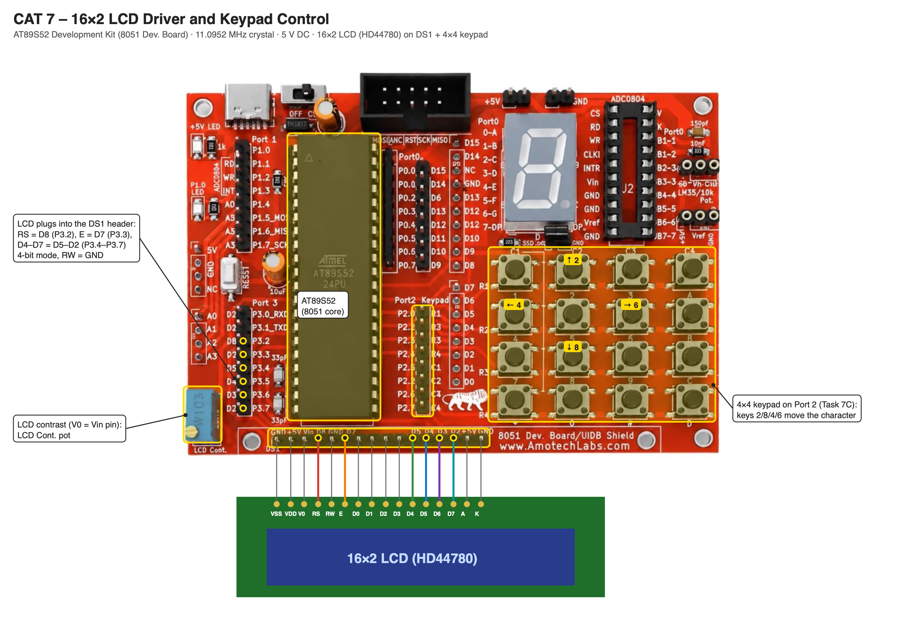

# TASK 7B Cursor Positioning and Dynamic Value Update

**Experiment:** [CONTINUOUS ASSESSMENT 7 – 16×2 LCD Driver Development and Dynamic Display Control](../README.md)

---

### 1. Hardware Used

- **Microcontroller:** AT89S52 (8051 core) on the AT89S52 development kit
- **LCD Pins:** LCD plugged into the DS1 header – RS → P3.2 (D8), E → P3.3 (D7), D4–D7 → P3.4–P3.7 (D5–D2), RW → GND (4-bit mode)
- **Peripheral:** Built-in 16×2 character LCD (HD44780-compatible)
- **Power Supply:** 5V DC

### 2. Core Logic / Pseudocode / Code Base

**Working Principle:**

The driver from Task 7A is extended with cursor positioning and value display. `lcd_goto(row, col)` sends `0x80 + col` for row 1 or `0xC0 + col` for row 2. `lcd_puts()` writes a string and `lcd_print_number()` converts a number into digits (`value % 10 + '0'`) and prints them in order. The program shows `HI DA` on row 1 and `Shift:` with a changing number on row 2, then shifts the display right (`0x1C`) 22 times before returning home (`0x02`).

**Pseudocode:**

1. Initialize the LCD.
2. Display `HI DA` at (0, 0) and `Shift:` at (1, 0).
3. Clear the old number at (1, 7) and print the current shift count.
4. If the count is 22, send Return Home and reset the count; otherwise shift the display right and increment the count.
5. Wait and repeat.

**Code Base:**

- `lcd_goto(row, column)`, `lcd_puts(string)` and `lcd_print_number(value)` build on `lcd_cmd()` and `lcd_data()`.

### 3. Inference

The cursor can be placed at any row and column, and the number on row 2 updates on every step without rewriting the rest of the display.
