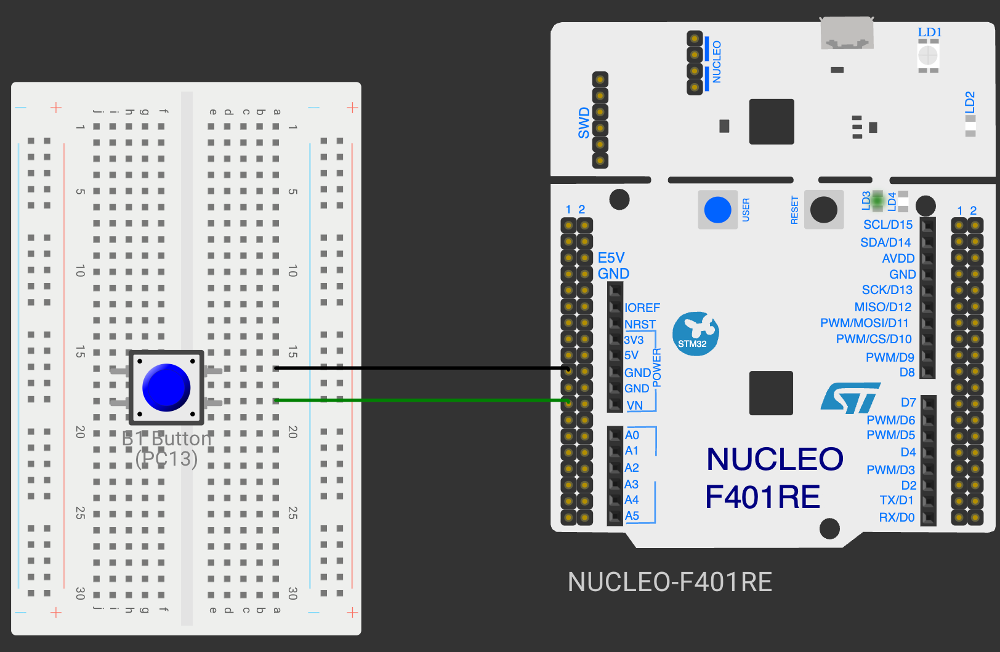

# EXPERIMENT DETAILS

**EXP:** CONTINUOUS ASSESSMENT 11

**DATE:** DD/MM/YYYY

**NAME OF EXP:** STM32F401RE Cortex-M4: GPIO and User Input Programming

**HARDWARE SETUP / PLATFORM:** CubeMX + STM32CubeIDE + STM32 Nucleo Development Board NUCLEO-F401RE (STM32F401RET6)

---

## TASK 1 On-board LED Bring-Up

### 1. Circuit Diagram

The experiment uses the onboard LED of the NUCLEO-F401RE.

- **Development Board:** NUCLEO-F401RE
- **Microcontroller IC:** STM32F401RET6 (ARM Cortex-M4 with FPU, 84 MHz)
- **GPIO Pin:** PA5 (output, push-pull)
- **Peripheral:** Onboard green LED LD2 (active-high)
- **Power Supply:** 5 V over the ST-LINK USB connector

### 2. Core Logic / Pseudocode / Code Base

**Working Principle:**

The NUCLEO-F401RE has no crystal for the STM32; it receives an 8 MHz clock from the onboard ST-LINK, so CubeMX sets the HSE to bypass mode. The PLL (PLLM ÷4, PLLN ×84, PLLP ÷2) raises this to the 84 MHz maximum system clock. PA5 is configured as a push-pull output to drive LD2, and the LED is toggled every 500 ms using `HAL_Delay()`, so it blinks at a fixed 1 Hz.

**Pseudocode:**

1. Initialize the HAL library and configure the 84 MHz system clock.
2. Configure PA5 as output and turn LD2 OFF.
3. Toggle PA5.
4. Wait 500 ms.
5. Repeat continuously.

**Code Base:**

- **Project folder:** [`TASK11A`](TASK11A/)
- `HAL_GPIO_TogglePin(GPIOA, GPIO_PIN_5)` toggles LD2.
- `HAL_Delay(500)` sets the fixed blink interval (based on the 1 ms SysTick).

### 3. Inference

LD2 blinks at a fixed interval, verifying the NUCLEO-F401RE hardware, the clock configuration and the GPIO output configuration.

---

## TASK 2 On-board Switch Control with State Remembrance

### 1. Circuit Diagram

- **Development Board:** NUCLEO-F401RE
- **Microcontroller IC:** STM32F401RET6
- **GPIO Pins:** PA5 (LED output), PC13 (button input, pull-up)
- **Peripherals:** Onboard LED LD2 (active-high), onboard blue user button B1 (active-low)
- **Power Supply:** 5 V over the ST-LINK USB connector

### 2. Core Logic / Pseudocode / Code Base

**Working Principle:**

PC13 is configured as an input with pull-up, so B1 reads HIGH when released and LOW when pressed. The program detects the press and release edges of B1 and toggles LD2 on a valid press. Since the LED is only changed on a toggle, it keeps (remembers) its new state after the button is released. Presses shorter than 30 ms are ignored as switch bounce.

**Pseudocode:**

1. Configure PC13 as input with pull-up and PA5 as output.
2. On a press edge (HIGH → LOW), record the press time.
3. On a release edge (LOW → HIGH), calculate the press duration.
4. If the duration is at least 30 ms, toggle LD2; shorter pulses are ignored as bounce.
5. Keep the LED in its new state until the next valid press.
6. Repeat continuously.

**Code Base:**

- **Project folder:** [`TASK11B`](TASK11B/)
- `HAL_GPIO_ReadPin(GPIOC, GPIO_PIN_13)` reads B1.
- `prev` stores the previous button state for edge detection and `press_t` the press time.
- `HAL_GPIO_TogglePin(GPIOA, GPIO_PIN_5)` toggles LD2.

### 3. Inference

Each valid press of B1 toggles LD2, and the LED stays in its new state after the button is released. Edge detection with a minimum press time gives one toggle per press.

---

## TASK 3 Short-Press and Long-Press Detection

### 1. Circuit Diagram

The same circuit as Task 2 is used.

- **Development Board:** NUCLEO-F401RE
- **Microcontroller IC:** STM32F401RET6
- **GPIO Pins:** PA5 (LED output), PC13 (button input, pull-up)
- **Peripherals:** Onboard LED LD2, onboard user button B1
- **Power Supply:** 5 V over the ST-LINK USB connector

### 2. Core Logic / Pseudocode / Code Base

**Working Principle:**

The duration of each press is measured with `HAL_GetTick()` time stamps, without blocking delays, and the STM32 performs a different action for each type of press:

| Press duration | Type | Action |
|---|---|---|
| < 30 ms | Bounce | Ignored |
| 30 ms – 499 ms | Short press | Toggle LD2 (when not blinking) |
| ≥ 500 ms | Long press | Turn blinking mode ON / OFF |

**Pseudocode:**

1. On a press edge, record the start time.
2. On a release edge, calculate `duration = release − start`.
3. If the duration is 500 ms or more, toggle the blinking mode.
4. Else, if the duration is at least 30 ms and blinking mode is off, toggle LD2.
5. If blinking mode is on, toggle LD2 every 200 ms.
6. Repeat continuously.

**Code Base:**

- **Project folder:** [`TASK11C`](TASK11C/)
- `blink` holds the blinking mode, `press_t` the press start time and `blink_t` the last blink toggle time.
- Unsigned subtraction `now - press_t` gives the correct duration even when the tick counter wraps around.

### 3. Inference

The STM32 distinguishes short and long presses of B1: a short press toggles LD2 and a long press starts or stops blinking. Measuring the press with time stamps keeps the loop running, so the LED blinks and the button is read at the same time.
