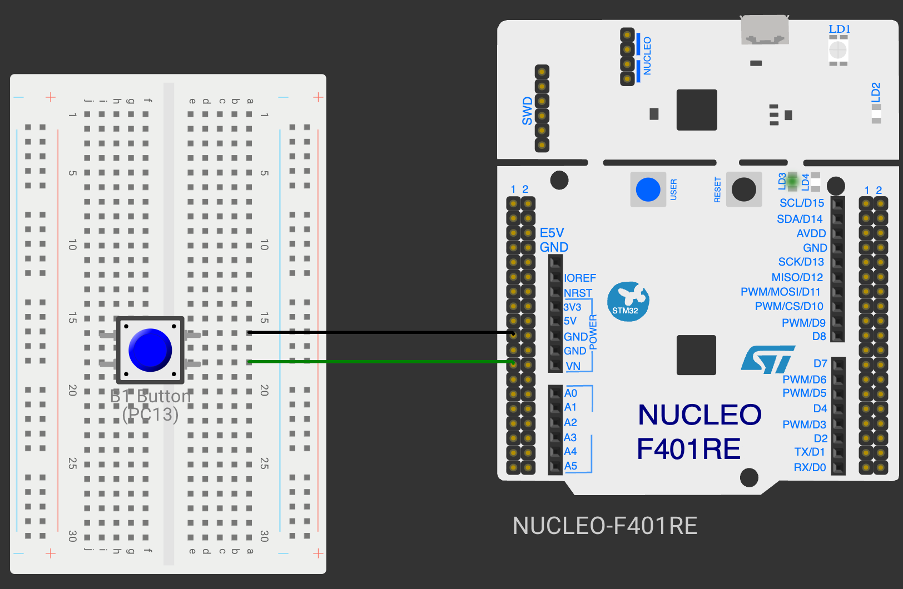

# TASK 11B Observe the HTTP Request and Construct a Static HTTP Response

**Experiment:** [CONTINUOUS ASSESSMENT 11 – HTTP Server - STM32–Wemos Wi-Fi Modem Using AT Commands](../README.md)

---

### 1. Hardware Used

- **Development Board:** STM32 Blue Pill
- **Microcontroller IC:** STM32F103C8T6 (ARM Cortex-M3, 72 MHz)
- **UART1 Pins (Wemos):** PA9 (USART1_TX) → Wemos RX, PA10 (USART1_RX) ← Wemos TX
- **UART2 Pins (PC):** PA2 (USART2_TX) → converter RX, PA3 (USART2_RX) ← converter TX
- **Peripherals:** Wemos D1 Mini (ESP8266) running AT firmware, USB-to-TTL (3.3 V) converter to PuTTY, browser on the same Wi-Fi network
- **Power Supply:** Wemos powered from 5 V; STM32, Wemos and converter share a common GND



### 2. Core Logic / Pseudocode / Code Base

**Working Principle:**

After the TCP server of Task 11A is started, a browser opening `http://<IP Address>/` generates an `+IPD` notification containing the received network data:

```
+IPD,0,XXX:GET / HTTP/1.1
Host: 192.168.1.105
...
```

The STM32 receives the ESP8266 data with a USART1 interrupt, stores the request for the link, prints it on the PC terminal and constructs a static HTTP response (status line, headers, blank line, HTML body). The response is sent by splitting CIPSEND into two steps:

- **Step 1 — CIPSEND command:** `AT+CIPSEND=<link_id>,<data_length>`; the ESP8266 replies with the `>` prompt.
- **Step 2 — HTTP response:** the response string is transmitted:

```
HTTP/1.1 200 OK\r\n
Content-Type: text/html\r\n
Content-Length: <body_length>\r\n
\r\n
<html><body><h1>STM32 IoT Node</h1></body></html>
```

```
Browser ──GET /──► ESP8266 ──+IPD──► STM32 ──construct HTTP response──► ESP8266 ──TCP──► Browser
```

**Pseudocode:**

1. Connect to Wi-Fi and start the TCP server (Task 11A) and enable USART1 interrupt reception.
2. In the interrupt, collect lines from the ESP8266; on `+IPD,<link>,<len>:<data>` store the request for that link.
3. In the main loop, for each link holding a request, print `+IPD,<link>:<request>` on the PC terminal and extract the path after `GET`.
4. For `/`, construct the static HTTP response with `Content-Length = strlen(body)`; otherwise send `Page not found`.
5. Step 1: send `AT+CIPSEND=<link>,<length>` and wait for `>`.
6. Step 2: transmit the response, wait for `SEND OK`, then close the link with `AT+CIPCLOSE=<link>`.

**Code Base:**

- The ESP8266 / HTTP server functions are reused from the BME280 HTTP experiment (CAT13): `initServer()` (`AT+CIPMUX=1`, `AT+CIPSERVER=1,80`), `HAL_UART_RxCpltCallback()` (tracks `CONNECT`, `+IPD`, `CLOSED`), `handleResponse()` and `sendHTML()`.
- `handleRouting()` prints the `+IPD` request and calls `sendHTML("<html><body><h1>STM32 IoT Node</h1></body></html>", "text/html", link)`.
- `sendHTML()` builds the response with `snprintf()` and performs the two CIPSEND steps.

**PC Terminal Output:**

```
TCP server started on port 80
+IPD,0:GET / HTTP/1.1
>> AT+CIPSEND=0,113
<< >
<< SEND OK
```

### 3. Inference

The browser shows the "STM32 IoT Node" page served by the STM32. The request arrives as plain text inside an `+IPD` frame, and the STM32 builds the complete HTTP response itself; the ESP8266 only carries the bytes over TCP after the `AT+CIPSEND` prompt.
