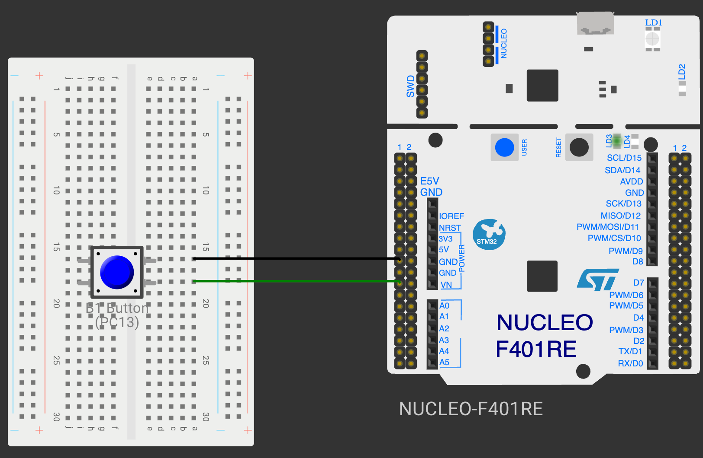

# EXPERIMENT DETAILS

**EXP:** CONTINUOUS ASSESSMENT 12

**DATE:** DD/MM/YYYY

**NAME OF EXP:** STM32F401RE Cortex-M4: GPIO and User Input Programming

**HARDWARE SETUP / PLATFORM:** CubeMX + STM32CubeIDE + STM32 Nucleo Development Board NUCLEO-F401RE (STM32F401RET6)

---

## Overview

Bring up the NUCLEO-F401RE (Cortex-M4) and program its GPIO with CubeMX and the HAL library, using the on-board LED LD2 (PA5) and user button B1 (PC13). The clock tree is configured for 84 MHz from the ST-LINK's 8 MHz clock (HSE bypass).

**Expected outcome:** The on-board LED blinks, toggles with the user button and remembers its state, and reacts differently to short and long button presses.

## Circuit Diagram

- **Development Board:** NUCLEO-F401RE
- **Microcontroller IC:** STM32F401RET6 (ARM Cortex-M4 with FPU, 84 MHz)
- **GPIO Pin:** PA5 (output, push-pull)
- **Peripheral:** Onboard green LED LD2 (active-high)
- **Power Supply:** 5 V over the ST-LINK USB connector

## Tasks

| Task | What it does | Outcome |
|---|---|---|
| [TASK 12A On-board LED Bring-Up](TASK12A/) | Blinks LD2 at a fixed 500 ms interval | Board, clock and GPIO output verified |
| [TASK 12B On-board Switch Control with State Remembrance](TASK12B/) | Each valid B1 press toggles LD2; the LED keeps its state after release | Button control with state remembrance |
| [TASK 12C Short-Press and Long-Press Detection](TASK12C/) | Short press toggles LD2; long press (≥ 500 ms) starts / stops blinking | Short and long presses distinguished |

Each task folder contains its STM32CubeMX / STM32CubeIDE project and a README with the task's hardware, core logic, pseudocode, code base and inference.
