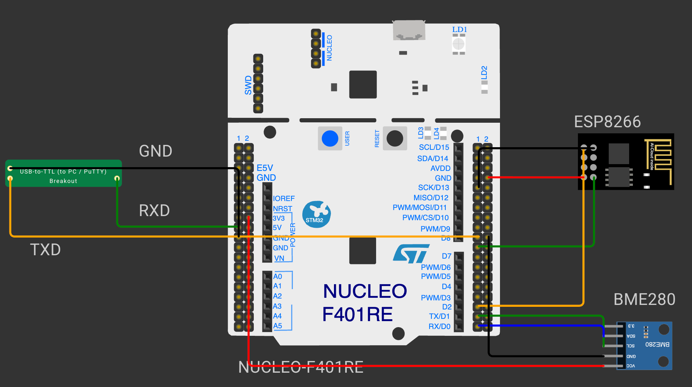

# EXPERIMENT DETAILS

**EXP:** CONTINUOUS ASSESSMENT 12

**DATE:** DD/MM/YYYY

**NAME OF EXP:** BME280 Sensor Interfacing Using I²C and Bosch Sensor API

**HARDWARE SETUP / PLATFORM:** CubeMX + STM32CubeIDE + STM32 Nucleo Development Board NUCLEO-F401RE (STM32F401RET6) + Bosch BME280 Sensor + Wemos D1 Mini (ESP8266) Wi-Fi Module + USB-to-TTL Serial Converter

---

## STEP 1–3 BME280 Sensor Interfacing Using I²C and Bosch Sensor API

### 1. Circuit Diagram

The BME280 sensor is connected to the NUCLEO-F401RE over I²C.

- **Development Board:** NUCLEO-F401RE
- **Microcontroller IC:** STM32F401RET6 (ARM Cortex-M4 with FPU, 84 MHz)
- **I²C Pins:** PB6 (I2C1_SCL) → BME280 SCL, PB7 (I2C1_SDA) ↔ BME280 SDA
- **Peripheral:** Bosch BME280 module (temperature, pressure, humidity), I²C address 0x76 (SDO to GND)
- **Power Supply:** BME280 powered from the Nucleo 3.3 V pin, common GND



### 2. Core Logic / Pseudocode / Code Base

**Working Principle:**

I2C1 is configured as an I²C master at 100 kHz. The official Bosch Sensortec BME280 Sensor API (`bme280.c`, `bme280.h`, `bme280_defs.h`, v3.5.1) is added to `Core/Src` and `Core/Inc`. The API does not access the hardware itself; it calls three STM32-specific functions supplied through the `bme280_dev` structure. `bme280_init()` reads the chip ID from register 0xD0, resets the sensor and loads its calibration (trim) data. The sensor is then configured and placed in normal mode, and `bme280_get_sensor_data()` returns compensated temperature, pressure and humidity.

**Pseudocode:**

1. Initialize HAL, the system clock and I2C1.
2. Set the sensor address (0x76) and connect the read, write and delay functions to the `bme280_dev` structure.
3. Call `bme280_init()` to check the chip ID and load the calibration data; stop on error.
4. Read the current settings, set temperature, pressure and humidity oversampling to 2× and the filter off, and write them.
5. Set the sensor to normal mode for continuous measurement.
6. In the loop, read the compensated data and convert the pressure from Pa to hPa.
7. Repeat every 2 seconds.

**Code Base:**

| Bosch API needs | Implemented as | HAL function |
|---|---|---|
| Read registers | `user_i2c_read()` | `HAL_I2C_Mem_Read()` |
| Write registers | `user_i2c_write()` | `HAL_I2C_Mem_Write()` |
| Delay | `user_delay_us()` | `HAL_Delay()` (rounded up to ms) |

- `bme280_set_sensor_settings(BME280_SEL_ALL_SETTINGS, &settings, &dev)` writes oversampling, filter and standby time.
- `bme280_set_sensor_mode(BME280_POWERMODE_NORMAL, &dev)` starts continuous measurement.
- `temperature = comp_data.temperature`, `pressure = comp_data.pressure / 100.0f`, `humidity = comp_data.humidity`.

### 3. Inference

The STM32 communicates with the BME280 over I²C, the correct chip ID is read and the Bosch API produces compensated temperature (°C), pressure (hPa) and humidity (%RH). Supplying only the read, write and delay functions lets the Bosch driver handle the register map and compensation formulas.

---

## Raw HTTP Response with BME280 Data

### 1. Circuit Diagram

The circuit from Step 1–3 is extended with the Wi-Fi module and a debug UART.

- **Development Board:** NUCLEO-F401RE
- **Microcontroller IC:** STM32F401RET6
- **I²C Pins:** PB6 (SCL), PB7 (SDA) → BME280
- **UART1 Pins (Wemos):** PA9 (USART1_TX) → Wemos RX, PA10 (USART1_RX) ← Wemos TX
- **UART6 Pins (PC):** PC6 (USART6_TX) → converter RX, PC7 (USART6_RX) ← converter TX
- **Peripherals:** BME280, Wemos D1 Mini (ESP8266) running AT firmware, USB-to-TTL converter to PuTTY
- **Power Supply:** BME280 from 3.3 V, Wemos from 5 V, common GND


### 2. Core Logic / Pseudocode / Code Base

**Working Principle:**

The ESP8266 joins the Wi-Fi network using AT commands and is set up as a TCP server on port 80 (`AT+CIPMUX=1`, `AT+CIPSERVER=1,80`). Bytes from the ESP8266 are received with a UART interrupt, which tracks client connections (`CONNECT`, `CLOSED`) and stores incoming requests (`+IPD`). The main loop answers each pending request with a raw HTTP response whose Content-Length is calculated from the actual body length, and sends it with `AT+CIPSEND`. A request for `/` returns the current temperature.

**Pseudocode:**

1. Initialize the BME280 (Step 1–3).
2. Initialize the ESP8266 (`ATE0`, `AT`), set station mode and join the Wi-Fi network.
3. Print the IP address on the PC terminal (USART6).
4. Start the TCP server on port 80 and enable interrupt reception on USART1.
5. In the loop:
   - for each connection holding a request, extract the path after `GET`;
   - if the path is `/`, build the response body from the temperature, else `Page not found`;
   - build the HTTP response with `Content-Length = strlen(body)`;
   - send `AT+CIPSEND=<link>,<length>`, wait for `>`, send the response, wait for `SEND OK`, then `AT+CIPCLOSE=<link>`;
   - read new sensor data.
6. Repeat every 2 seconds.

**Code Base:**

- `HAL_UART_RxCpltCallback()` builds lines from the ESP8266 and updates the `connections[]` state.
- `handleResponse()` and `handleRouting()` extract the requested path and choose the response.
- `sendHTML()` builds the response with `snprintf()`:

```
HTTP/1.1 200 OK
Content-Type: text/html
Content-Length: <strlen(body)>
Connection: close

<body>
```

- `onWifiDisconnect()` waits for `WIFI GOT IP` and restarts the server if the Wi-Fi connection drops.

### 3. Inference

Opening `http://<IP Address>/` in a browser on the same network shows the temperature measured by the BME280. The STM32 builds a valid raw HTTP response with the correct Content-Length and sends it through the ESP8266, showing how sensor data can be served over Wi-Fi using AT commands.
