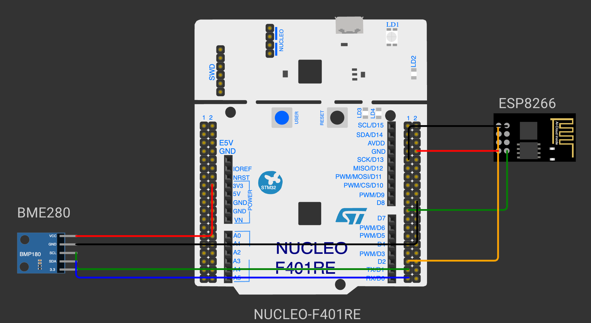

# EXPERIMENT DETAILS

**EXP:** CONTINUOUS ASSESSMENT 13

**DATE:** DD/MM/YYYY

**NAME OF EXP:** BME280 Sensor Interfacing Using I²C and (MQTT) using Custom Built ESP8266 API

**HARDWARE SETUP / PLATFORM:** CubeMX + STM32CubeIDE + STM32 Nucleo Development Board NUCLEO-F401RE (STM32F401RET6) + Bosch BME280 Sensor + Wemos D1 Mini (ESP8266) Wi-Fi Module + MQTT Broker (broker.emqx.io)

---

## STEP 1–3 Implement Interface Wrappers (ESP8266 MQTT API)

### 1. Circuit Diagram

The NUCLEO-F401RE drives the ESP8266 over UART to connect to an MQTT broker.

- **Development Board:** NUCLEO-F401RE
- **Microcontroller IC:** STM32F401RET6 (ARM Cortex-M4 with FPU, 84 MHz)
- **UART1 Pins (Wemos):** PA9 (USART1_TX) → Wemos RX, PA10 (USART1_RX) ← Wemos TX
- **Peripheral:** Wemos D1 Mini (ESP8266) running AT firmware
- **Network:** Wi-Fi access point → MQTT broker `broker.emqx.io`, TCP port 1883
- **Power Supply:** Wemos powered from 5 V, common GND



### 2. Core Logic / Pseudocode / Code Base

**Working Principle:**

The custom ESP8266 library (`ESPLib.c` in `Core/Src`, `ESPLib.h` in `Core/Inc`) is added to the project. It sends AT commands to the ESP8266 and builds MQTT packets byte by byte. The ESP8266 joins the Wi-Fi network, opens a TCP connection to the broker on port 1883, and the STM32 sends an MQTT CONNECT packet through that connection using `AT+CIPSEND`.

**Pseudocode:**

1. Initialize HAL, the system clock, I2C1, USART1 and USART6.
2. Initialize the ESP8266 in station mode (`AT`, `AT+CWMODE=1`).
3. Connect to the Wi-Fi network (`AT+CWQAP`, `AT+CWJAP`).
4. Open a TCP connection to `broker.emqx.io:1883` (`AT+CIPSTART`).
5. Set the MQTT parameters: keep-alive 500 s, clean session, client ID.
6. Send the MQTT CONNECT packet to the broker.

**Code Base:**

- `ESP8266_Init(StationMode, huart1)` checks the modem and sets station mode.
- `ESP8266_wifiConnect(ssid, password)` joins the access point.
- `ESP8266_portConnect("TCP", "broker.emqx.io", "1883")` opens the TCP connection.
- `MQTT_InitTypeDef_t mqttSetting` holds `keepAlive = 500`, `connectFlag = CleanSession` and `clientID`.
- `MQTT_connectBroker(&mqttSetting)` builds the CONNECT packet (`0x10`, remaining length, `"MQTT"`, level `0x04`, flags, keep-alive, client ID) and sends it with `ESP8266_sendMessage()`.

### 3. Inference

The STM32 connects to the public MQTT broker through the ESP8266. MQTT runs on top of the TCP connection provided by the ESP8266, and the STM32 only needs to send the correctly framed MQTT packets as raw bytes.

---

## Develop the Application

### 1. Circuit Diagram

The circuit from Step 1–3 is extended with the BME280 sensor.

- **Development Board:** NUCLEO-F401RE
- **Microcontroller IC:** STM32F401RET6
- **I²C Pins:** PB6 (I2C1_SCL) → BME280 SCL, PB7 (I2C1_SDA) ↔ BME280 SDA
- **UART1 Pins (Wemos):** PA9 (USART1_TX), PA10 (USART1_RX)
- **Peripherals:** Bosch BME280 module (I²C address 0x76), Wemos D1 Mini (ESP8266)
- **Power Supply:** BME280 from 3.3 V, Wemos from 5 V, common GND


### 2. Core Logic / Pseudocode / Code Base

**Working Principle:**

The Bosch BME280 API is used as in the previous experiment: the read, write and delay functions are connected to the `bme280_dev` structure, the sensor is initialized (chip ID and calibration data), configured with 2× oversampling and the filter off, and placed in normal mode. Every second the compensated readings are formatted as a JSON payload and published to the MQTT topic `stm32/bme280` with QoS 0, where any subscribed MQTT client can receive them.

**Pseudocode:**

1. Connect to the broker (Step 1–3).
2. Declare the BME280 device structure and connect the I²C read, write and delay functions.
3. Initialize the BME280, set oversampling to 2× and the filter off, and set normal mode.
4. In the loop:
   - read the compensated temperature, pressure and humidity;
   - convert the pressure from Pa to hPa;
   - build the JSON payload `{"t":<temperature>,"p":<pressure>,"h":<humidity>}`;
   - publish it to `stm32/bme280` with QoS 0.
5. Wait 1 second and repeat.

**Code Base:**

- `bme280_get_sensor_data(BME280_ALL, &comp_data, &dev)` returns the compensated readings.
- `snprintf(buf, sizeof buf, "{\"t\":%.1f,\"p\":%.1f,\"h\":%.1f}", temperature, pressure, humidity)` builds the JSON payload.
- `MQTT_publishTopic("stm32/bme280", buf, QoS0)` builds the PUBLISH packet (`0x30`, remaining length, topic length, topic, message) and sends it through the ESP8266.

**Received Data (MQTT client subscribed to `stm32/bme280`):**

```
{"t":28.4,"p":1008.7,"h":62.3}
{"t":28.4,"p":1008.6,"h":62.4}
```

### 3. Inference

The STM32 publishes the BME280 temperature, pressure and humidity as JSON to the MQTT broker every second. Because MQTT decouples the publisher from the subscribers, any client such as Node-RED's `mqtt in` node can receive the readings without changes to the firmware.
