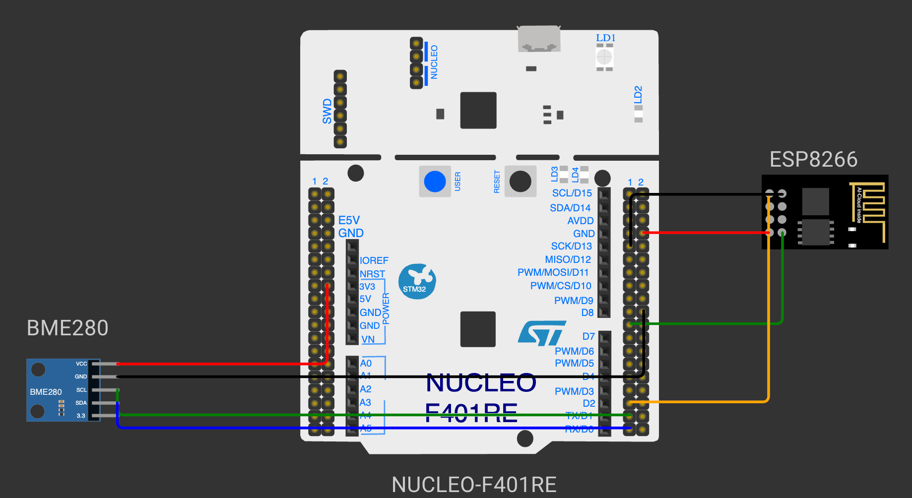

# TASK 13A BME280 Sensor Interfacing Using I²C and Bosch Sensor API

**Experiment:** [CONTINUOUS ASSESSMENT 13 – BME280 Sensor Interfacing Using I²C and Bosch Sensor API](../README.md)

---

### 1. Hardware Used

- **Development Board:** NUCLEO-F401RE
- **Microcontroller IC:** STM32F401RET6 (ARM Cortex-M4 with FPU, 84 MHz)
- **I²C Pins:** PB6 (I2C1_SCL) → BME280 SCL, PB7 (I2C1_SDA) ↔ BME280 SDA
- **UART6 Pins (PC):** PC6 (USART6_TX) → converter RX, PC7 (USART6_RX) ← converter TX
- **Peripherals:** Bosch BME280 module (temperature, pressure, humidity), I²C address 0x76 (SDO to GND); USB-to-TTL converter to PuTTY (115200-8-N-1)
- **Power Supply:** BME280 powered from the Nucleo 3.3 V pin, common GND



### 2. Core Logic / Pseudocode / Code Base

**Working Principle:**

I2C1 is configured as an I²C master at 100 kHz. The official Bosch Sensortec BME280 Sensor API (`bme280.c`, `bme280.h`, `bme280_defs.h`, v3.5.1) is added to `Core/Src` and `Core/Inc`. The API does not access the hardware itself; it calls three STM32-specific functions supplied through the `bme280_dev` structure. `bme280_init()` reads the chip ID from register 0xD0, resets the sensor and loads its calibration (trim) data. The sensor is then configured and placed in normal mode, and `bme280_get_sensor_data()` returns compensated temperature, pressure and humidity, which are printed on the PC terminal every second through USART6.

**Pseudocode:**

1. Initialize HAL, the system clock and I2C1.
2. Set the sensor address (0x76) and connect the read, write and delay functions to the `bme280_dev` structure.
3. Call `bme280_init()` to check the chip ID and load the calibration data; print the chip ID, or stop on error.
4. Read the current settings, set temperature, pressure and humidity oversampling to 2× and the filter off, and write them.
5. Set the sensor to normal mode for continuous measurement.
6. In the loop, read the compensated data and convert the pressure from Pa to hPa.
7. Print the temperature, pressure and humidity on the PC terminal.
8. Repeat every second.

**Code Base:**


| Bosch API needs | Implemented as | HAL function |
|---|---|---|
| Read registers | `user_i2c_read()` | `HAL_I2C_Mem_Read()` |
| Write registers | `user_i2c_write()` | `HAL_I2C_Mem_Write()` |
| Delay | `user_delay_us()` | `HAL_Delay()` (rounded up to ms) |

- `bme280_set_sensor_settings(BME280_SEL_ALL_SETTINGS, &settings, &dev)` writes oversampling, filter and standby time.
- `bme280_set_sensor_mode(BME280_POWERMODE_NORMAL, &dev)` starts continuous measurement.
- `temperature = comp_data.temperature`, `pressure = comp_data.pressure / 100.0f`, `humidity = comp_data.humidity`.
- `sendUART(&huart6, …)` prints each value formatted with `snprintf()`.

**PC Terminal Output:**

```
BME280 chip ID : 0x60
BME280 configured
Temperature : 28.45 °C
Pressure    : 1008.72 hPa
Humidity    : 62.30 %RH
```

### 3. Inference

The STM32 communicates with the BME280 over I²C, the correct chip ID (0x60) is read and the Bosch API produces compensated temperature (°C), pressure (hPa) and humidity (%RH). Supplying only the read, write and delay functions lets the Bosch driver handle the register map and compensation formulas.
