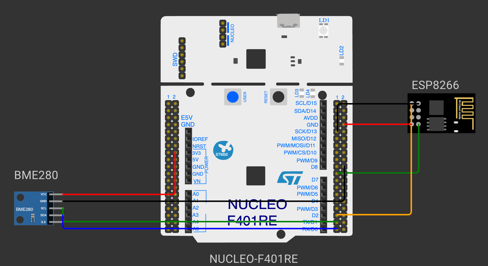

# EXPERIMENT DETAILS

**EXP:** CONTINUOUS ASSESSMENT 14 – IoT PROJECT

**DATE:** DD/MM/YYYY

**NAME OF EXP:** Server Rack Monitor – Temperature and Humidity Monitoring with STM32, ESP8266 (MQTT) and a Node-RED Dashboard

**HARDWARE SETUP / PLATFORM:** CubeMX + Keil MDK-ARM / STM32CubeIDE + STM32 Development Board Blue Pill STM32F103C6T6A + DHT11 Temperature and Humidity Sensor + Wemos D1 Mini (ESP8266) Wi-Fi Module + Warning LED + Buzzer + MQTT Broker (broker.emqx.io) + Node-RED Dashboard

---

## Overview

An IoT node that monitors the environment of a server rack. The STM32 reads the rack temperature and humidity from a DHT11 sensor, warns locally with an LED and a buzzer when the rack becomes too hot, and publishes every reading as JSON over Wi-Fi to an MQTT broker through an ESP8266. A Node-RED dashboard subscribes to the readings, shows them as gauges and a chart, raises a status / spoken alert, shuts down a computer in the rack when the temperature stays too high, and compares the rack with the outside weather from OpenWeatherMap.

**Expected outcome:** The rack temperature and humidity appear live on the Node-RED dashboard; above 30 °C the warning LED and buzzer turn on, the dashboard shows and announces the alert, and after three consecutive readings above 30 °C a shutdown command is sent to the computer in the rack.

## Circuit Diagram

- **Development Board:** STM32 Blue Pill
- **Microcontroller IC:** STM32F103C6T6A (ARM Cortex-M3, 72 MHz)
- **DHT11 Data Pin:** PB15 (single-wire data line)
- **UART1 Pins (Wemos):** PA9 (USART1_TX) → Wemos RX, PA10 (USART1_RX) ← Wemos TX
- **Warning LED:** PA5 (output, active-high)
- **Buzzer:** PA6 (output, active-high)
- **Status LED:** On-board LED on PC13 (active-low)
- **Peripherals:** DHT11 sensor module, Wemos D1 Mini (ESP8266) running AT firmware, warning LED, buzzer
- **Power Supply:** 3.3 V from the Blue Pill to the DHT11; Wemos powered from 5 V; common GND

## Tasks

| Task | What it does | Outcome |
|---|---|---|
| [TASK 14 Server Rack Monitor](TASK14/) | Reads the DHT11, drives the warning LED and buzzer above 30 °C, publishes `{"t":…,"h":…}` to `rack1/readings` over MQTT; Node-RED dashboard with gauges, chart, alerts, automatic shutdown and outside-weather comparison | Live rack monitoring with local and remote alerts |

The task folder contains the STM32CubeMX / Keil MDK-ARM / STM32CubeIDE project, the Node-RED flow (`flows.json`) and a README with the hardware, core logic, pseudocode, code base and inference.
