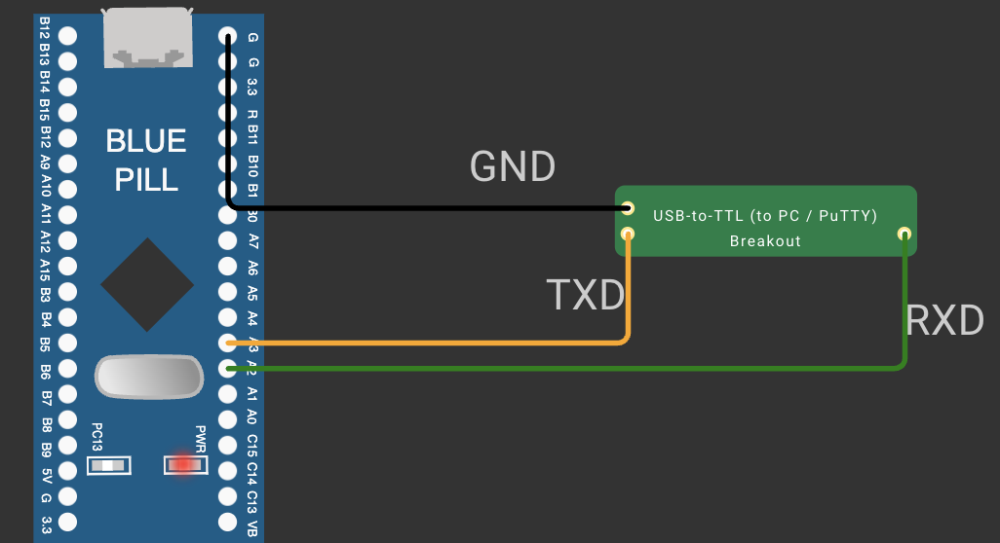

# EXPERIMENT DETAILS

**EXP:** CONTINUOUS ASSESSMENT 9

**DATE:** DD/MM/YYYY

**NAME OF EXP:** STM32 UART Command Controlled LED

**HARDWARE SETUP / PLATFORM:** CubeMX + STM32CubeIDE + STM32 Development Board Blue Pill STM32F103C6T6A + USB-to-TTL Serial Converter + PuTTY

---

## Overview

Configure the STM32 USART with CubeMX and the HAL library, communicate with a PC terminal (PuTTY) through a USB-to-TTL converter, and build a text-command interface that controls the on-board LED.

**Expected outcome:** Characters typed in PuTTY are echoed back, and the commands `LED ON`, `LED OFF` and `LED TOGGLE` control the on-board LED.

## Circuit Diagram

- **Development Board:** STM32 Blue Pill
- **Microcontroller IC:** STM32F103C6T6A
- **UART Pins:** PA2 (USART2_TX), PA3 (USART2_RX)
- **GPIO Pin:** PC13 (output, push-pull)
- **Peripherals:** Onboard LED on PC13 (active-low), USB-to-TTL converter to PuTTY
- **Power Supply:** 3.3 V from the board

## Tasks

| Task | What it does | Outcome |
|---|---|---|
| [TASK 9A Basic UART Communication](TASK9A/) | Transmits a character every second and echoes every received character | Bidirectional UART link at 115200-8-N-1 verified |
| [TASK 9B String-Based Application Logic](TASK9B/) | Collects characters until CR/LF and executes `LED ON` / `LED OFF` / `LED TOGGLE` | LED controlled by text commands; CR/LF behaviour understood |

Each task folder contains its STM32CubeMX / STM32CubeIDE project and a README with the task's hardware, core logic, pseudocode, code base and inference.
