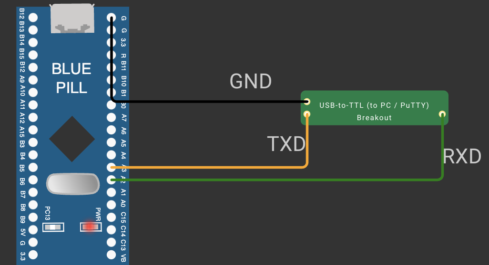

# EXPERIMENT DETAILS

**EXP:** CONTINUOUS ASSESSMENT 9

**DATE:** DD/MM/YYYY

**NAME OF EXP:** STM32 UART Command Controlled LED

**HARDWARE SETUP / PLATFORM:** CubeMX + STM32CubeIDE + STM32 Development Board Blue Pill STM32F103C6T6A + USB-to-TTL Serial Converter + PuTTY

---

## TASK 9A Basic UART Communication

### 1. Circuit Diagram

The STM32 communicates with a PC terminal through a USB-to-TTL serial converter.

- **Development Board:** STM32 Blue Pill
- **Microcontroller IC:** STM32F103C6T6A (ARM Cortex-M3, 72 MHz)
- **UART Pins:** PA2 (USART2_TX) → converter RX, PA3 (USART2_RX) ← converter TX
- **Peripherals:** USB-to-TTL (3.3 V) serial converter connected to the PC running PuTTY
- **Power Supply:** 3.3 V from the board; converter GND connected to board GND

### 2. Core Logic / Pseudocode / Code Base

**Working Principle:**

USART2 is configured in CubeMX for asynchronous mode at a standard serial setting of **115200 baud, 8 data bits, no parity, 1 stop bit** (115200-8-N-1). The program waits up to 1 second for a character from the PC:

- **Transmit a Character:** if nothing is received within 1 second, the character `A` is transmitted, so `A` appears on the terminal repeatedly.
- **Receive and Echo:** if a character is received, the same character is transmitted back, so every character typed in PuTTY is echoed on the terminal.

**Pseudocode:**

1. Initialize the HAL library, system clock, GPIO and USART2.
2. Wait up to 1 second for one character from the PC using `HAL_UART_Receive()`.
3. If a character is received, transmit the same character back.
4. Otherwise, transmit the character `A`.
5. Repeat continuously.

**Code Base:**

- `HAL_UART_Init()` (called from `MX_USART2_UART_Init()`) initializes USART2 with 115200-8-N-1.
- `HAL_UART_Receive(&huart2, &ch, 1, 1000)` waits up to 1 s for one character.
- `HAL_UART_Transmit(&huart2, &ch, 1, HAL_MAX_DELAY)` sends the received character back (echo).
- `HAL_UART_Transmit(&huart2, &txChar, 1, HAL_MAX_DELAY)` sends `A` when no character arrives.

### 3. Inference

The character `A` appears on the terminal once every second, and every character typed in PuTTY is echoed back, confirming that both the transmit and receive paths of the UART work and that the STM32 and the PC use the same baud rate and frame format.
