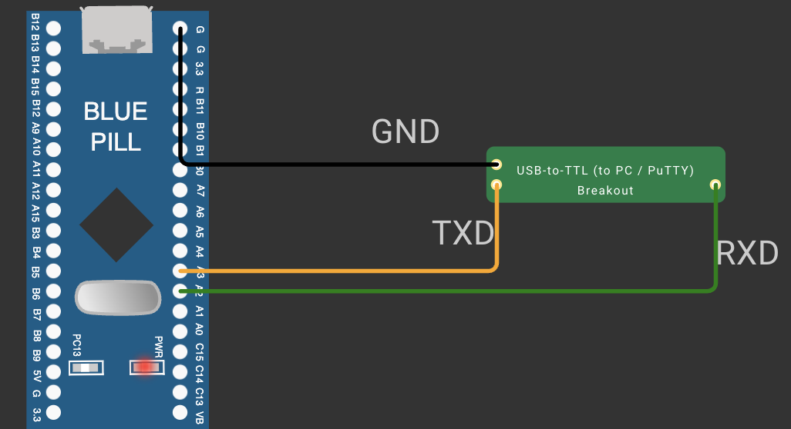

# TASK 9B String-Based Application Logic

**Experiment:** [CONTINUOUS ASSESSMENT 9 – STM32 UART Command Controlled LED](../README.md)

---

### 1. Hardware Used

- **Development Board:** STM32 Blue Pill
- **Microcontroller IC:** STM32F103C6T6A
- **UART Pins:** PA2 (USART2_TX), PA3 (USART2_RX)
- **GPIO Pin:** PC13 (output, push-pull)
- **Peripherals:** Onboard LED on PC13 (active-low), USB-to-TTL converter to PuTTY
- **Power Supply:** 3.3 V from the board



### 2. Core Logic / Pseudocode / Code Base

**Working Principle:**

The received characters are collected into a buffer to form a command string. When a Carriage Return (`\r`) or Line Feed (`\n`) is received, the command is complete: the buffer is terminated and compared with the known commands, and the matching LED action is performed and a confirmation message is sent back to the terminal. At start-up the four Carriage Return / Line Feed test strings are transmitted, and the LED starts OFF.

| Command | Action | Reply |
|---|---|---|
| `LED ON` | PC13 LOW (LED ON) | `LED turned ON` |
| `LED OFF` | PC13 HIGH (LED OFF) | `LED turned OFF` |
| `LED TOGGLE` | PC13 toggled | `LED toggled` |

**Pseudocode:**

1. Initialize the HAL library, clock, GPIO and USART2; turn the LED OFF.
2. Transmit the CR/LF test strings `"HELLO\r\n"`, `"HELLO\r"`, `"HELLO\n"` and `"HELLO\r\nWORLD\r\n"`, one second apart.
3. Receive one character and echo it back.
4. If the character is `\r` or `\n` and the buffer is not empty:
   - terminate the buffer with `'\0'`;
   - compare it with `LED ON`, `LED OFF` and `LED TOGGLE`, perform the matching action and send the reply;
   - clear the buffer.
5. Otherwise, add the character to the buffer.
6. Repeat continuously.

**Code Base:**

- `buf[128]` stores the command and `lastInd` tracks its length.
- `strcmp()` compares the received command with each known command.
- `HAL_GPIO_WritePin(GPIOC, GPIO_PIN_13, GPIO_PIN_RESET / GPIO_PIN_SET)` turns the LED ON / OFF.
- `HAL_GPIO_TogglePin(GPIOC, GPIO_PIN_13)` toggles the LED.
- `sendString()` transmits the replies and the CR/LF test strings with `HAL_UART_Transmit()`.

**PC Terminal Output:**

```
LED ON
LED turned ON
LED TOGGLE
LED toggled
```

**Carriage Return and Line Feed:**

The test strings sent at start-up show:

| Test string | Result in PuTTY |
|---|---|
| `"HELLO\r\n"` | `HELLO`, then the cursor moves to the start of the next line |
| `"HELLO\r"` | The cursor returns to the start of the same line, so the next text overwrites `HELLO` |
| `"HELLO\n"` | The cursor moves down one line but stays in the same column |
| `"HELLO\r\nWORLD\r\n"` | `HELLO` and `WORLD` on separate lines |

`\r` returns the cursor to the start of the line and `\n` moves it down one line, so both are needed to start a fresh line.

### 3. Inference

Typing `LED ON`, `LED OFF` or `LED TOGGLE` in PuTTY controls the onboard LED, and the STM32 confirms each command with a reply. Collecting characters until CR/LF and comparing the complete string turns the UART into a simple text command interface, demonstrating string handling on top of HAL UART communication.
